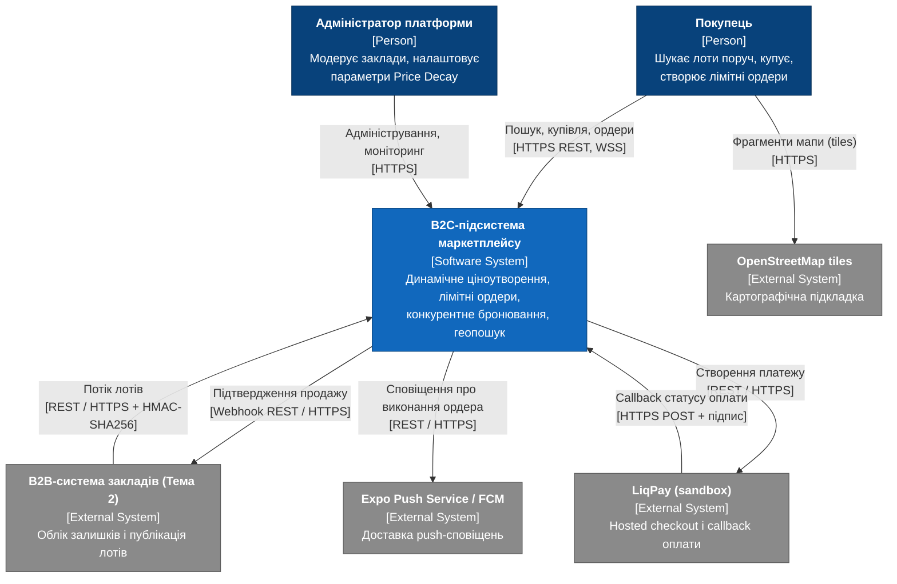
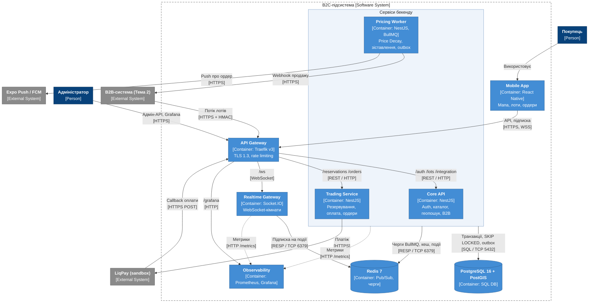
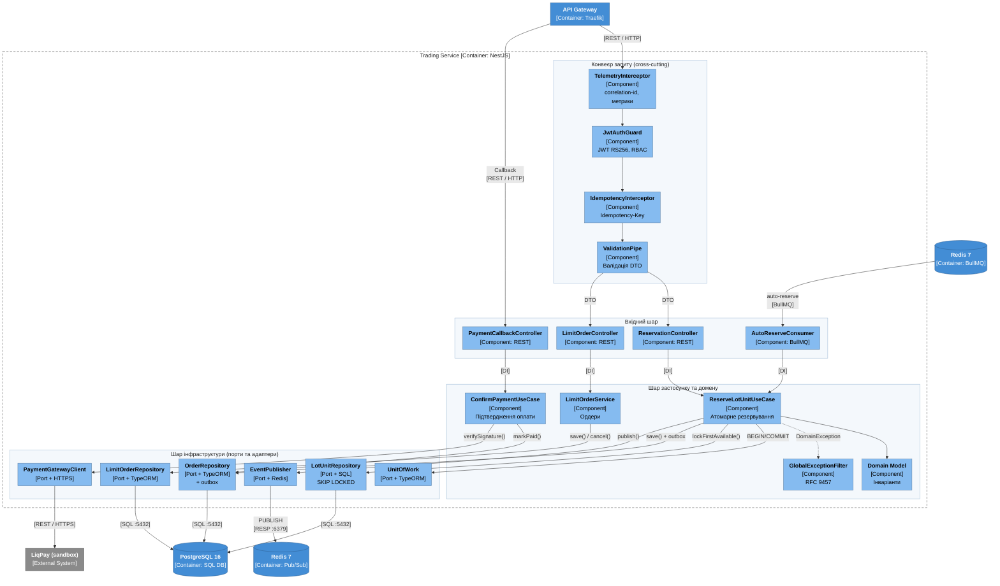

# РОЗДІЛ 2. ПРОЄКТУВАННЯ АРХІТЕКТУРИ СИСТЕМИ

Вхідний контракт вимог: [srs.md](./srs.md). Архітектурні рішення:
[adr/](./adr/).

## 2.1. Контекстне та контейнерне моделювання системи (C4 Model)

Діаграми побудовано в нотації C4 (Simon Brown) засобами Mermaid
`flowchart`: тип елемента вказано стереотипом у підписі ([Person],
[Software System], [External System], [Container: …],
[Component: …]), кольори відповідають палітрі C4, кожен зв'язок
підписано дією та протоколом у квадратних дужках. Вбудований
синтаксис `C4Context`/`C4Container` у Mermaid не розводить підписи
зв'язків і дає накладання тексту, тому для читабельності обрано
`flowchart` з автоматичною розкладкою.

### 2.1.1. C4 Level 1 — System Context

**Опис вузлів і зв'язків (Level 1):**

| Елемент | Тип | Відповідальність | Протокол |
|---|---|---|---|
| Покупець | Person | використовує мобільний клієнт | HTTPS REST, WSS |
| Адміністратор платформи | Person | адміністративні методи REST API, Grafana | HTTPS |
| B2C-підсистема | System | предмет кваліфікаційної роботи | — |
| B2B-система (Тема 2) | External System | джерело лотів ([SRS-FUN-01](./srs.md#srs-fun-01)), отримувач підтверджень ([SRS-FUN-12](./srs.md#srs-fun-12)) | REST / HTTPS, HMAC-SHA256 |
| LiqPay (sandbox) | External System | оплата без обробки даних карток ([SRS-NFR-COMP-02](./srs.md#srs-nfr-comp-02)) | REST / HTTPS, підписаний callback |
| Expo Push / FCM | External System | сповіщення про виконання лімітного ордера | REST / HTTPS |
| OpenStreetMap tiles | External System | картографічна підкладка клієнта | HTTPS |

### 2.1.2. C4 Level 2 — Container Diagram

**Опис контейнерів і трасування вимог (Level 2):**

| Контейнер | Технологія | Реалізовані вимоги | Рішення |
|---|---|---|---|
| Mobile App | React Native (Expo) | клієнт для [SRS-FUN-05](./srs.md#srs-fun-05), [SRS-FUN-13](./srs.md#srs-fun-13), [SRS-FUN-15](./srs.md#srs-fun-15) | — |
| API Gateway | Traefik v3 | [SRS-FUN-16](./srs.md#srs-fun-16), [SRS-NFR-SEC-02](./srs.md#srs-nfr-sec-02) | — |
| Core API | NestJS | [SRS-FUN-01](./srs.md#srs-fun-01)–[SRS-FUN-06](./srs.md#srs-fun-06), [SRS-FUN-17](./srs.md#srs-fun-17)–[SRS-FUN-19](./srs.md#srs-fun-19) | — |
| Trading Service | NestJS | [SRS-FUN-09](./srs.md#srs-fun-09), [SRS-FUN-11](./srs.md#srs-fun-11), [SRS-FUN-13](./srs.md#srs-fun-13), [SRS-FUN-14](./srs.md#srs-fun-14), [SRS-NFR-CONS-01](./srs.md#srs-nfr-cons-01) | [ADR-001](./adr/0001-choice-of-technology.md) |
| Pricing Worker | NestJS + BullMQ | [SRS-FUN-07](./srs.md#srs-fun-07), [SRS-FUN-08](./srs.md#srs-fun-08), [SRS-FUN-10](./srs.md#srs-fun-10), [SRS-FUN-12](./srs.md#srs-fun-12), [SRS-NFR-REL-03](./srs.md#srs-nfr-rel-03) | — |
| Realtime Gateway | NestJS + Socket.IO + Redis adapter | [SRS-FUN-15](./srs.md#srs-fun-15), [SRS-FUN-20](./srs.md#srs-fun-20), [SRS-NFR-PERF-03](./srs.md#srs-nfr-perf-03), [SRS-NFR-SCAL-01](./srs.md#srs-nfr-scal-01) | — |
| PostgreSQL 16 + PostGIS | SQL | єдине джерело істини, [SRS-NFR-REL-02](./srs.md#srs-nfr-rel-02) | [ADR-001](./adr/0001-choice-of-technology.md) |
| Redis 7 | BullMQ, Pub/Sub | транспорт задач і подій; не бере участі в гарантії коректності | [ADR-001](./adr/0001-choice-of-technology.md) |
| Observability | Prometheus, Grafana, Loki | [SRS-NFR-OBS-01](./srs.md#srs-nfr-obs-01), [SRS-NFR-REL-01](./srs.md#srs-nfr-rel-01) | — |

Core API, Trading Service і Pricing Worker на діаграмі згруповано в
«Сервіси бекенду», щоб спільні зв'язки зі сховищами не дублювалися:
усі три сервіси звертаються до PostgreSQL (SQL / TCP 5432) і Redis
(RESP / TCP 6379) — Core API для каталогу, геопошуку й кешу, Trading
Service для транзакцій SKIP LOCKED і задач auto-reserve, Pricing Worker
для пакетного оновлення цін, outbox і черг BullMQ; метрики всіх
сервісів збирає Observability через HTTP `/metrics`.
Протоколи: зовнішній трафік — лише через API Gateway (REST / HTTPS,
WSS, TLS 1.3); внутрішній трафік у мережі Docker — REST / HTTP і
WebSocket; доступ до сховищ — SQL / TCP 5432 та RESP / TCP 6379.
Контейнер Trading Service [C4 Container](#diagram-level2) реалізує
вимогу атомарного резервування [SRS-FUN-09](./srs.md#srs-fun-09) та
базується на рішенні [ADR-001](./adr/0001-choice-of-technology.md)
щодо `SELECT FOR UPDATE SKIP LOCKED`.

## 2.2. Компонентне моделювання критичного сервісу системи

### 2.2.1. C4 Level 3 — Component Diagram: Trading Service

Обрано Trading Service як контейнер з найбільшим інженерним ризиком:
він реалізує конкурентне резервування, оплату та виконання лімітних
ордерів.

### 2.2.2. Опис компонентів

**Наскрізні компоненти (cross-cutting).**

| Компонент | Роль | Вимоги |
|---|---|---|
| JwtAuthGuard | перевіряє підпис і строк дії access JWT, роль користувача | [SRS-FUN-04](./srs.md#srs-fun-04), [SRS-NFR-SEC-01](./srs.md#srs-nfr-sec-01) |
| ValidationPipe | відхиляє некоректні DTO з кодом 400 до входу в контролер | [SRS-NFR-SEC-04](./srs.md#srs-nfr-sec-04) |
| IdempotencyInterceptor | повертає збережену відповідь для повторного `Idempotency-Key` | [SRS-FUN-11](./srs.md#srs-fun-11) |
| GlobalExceptionFilter | перетворює доменні винятки на RFC 9457 (409 — немає одиниць, 410 — лот прострочений) | [SRS-FUN-09](./srs.md#srs-fun-09) |
| TelemetryInterceptor | JSON-логи з correlation-id, гістограма `http_request_duration_seconds` | [SRS-NFR-OBS-01](./srs.md#srs-nfr-obs-01) |

**Вхідний шар (Inbound).** `ReservationController`,
`LimitOrderController` і `PaymentCallbackController` не містять
бізнес-логіки й не мають доступу до репозиторіїв: вони перетворюють
DTO на команду та викликають відповідний use case через інтерфейс,
зареєстрований у DI-контейнері NestJS. `AutoReserveConsumer` споживає
задачі `limit-order.triggered`, які створює Pricing Worker, і
викликає той самий `ReserveLotUnitUseCase`, що й REST-контролер; отже,
ручна та автоматична купівля проходять однаковий шлях резервування
([SRS-FUN-14](./srs.md#srs-fun-14)).

**Шар застосунку та домену (Core).** `ReserveLotUnitUseCase` відкриває
транзакцію через `UnitOfWork`, викликає
`LotUnitRepository.lockFirstAvailable()`, перевіряє інваріанти
доменної моделі (лот не прострочений, ціна зафіксована), зберігає
замовлення й outbox-запис і після коміту публікує подію
`lot.stock_updated`. `ConfirmPaymentUseCase` перевіряє підпис
callback і переводить замовлення в `paid` лише з дозволеного стану.
Доменна модель не залежить від NestJS, TypeORM чи Redis.
`PaymentCallbackController` не проходить через `JwtAuthGuard`, оскільки
запит надходить від LiqPay: автентичність підтверджується перевіркою
підпису callback у `ConfirmPaymentUseCase`.

**Шар інфраструктури (Outbound).** Репозиторії, клієнт платежів і
публікатор подій оголошено як порти (TypeScript-інтерфейси) у шарі
застосунку, а реалізації — як адаптери в інфраструктурному модулі
(Dependency Inversion). `LotUnitRepository` використовує сирий SQL
для `FOR UPDATE SKIP LOCKED` відповідно до
[ADR-001](./adr/0001-choice-of-technology.md); інші репозиторії —
TypeORM.

## 2.3. Документування архітектурних рішень (Architecture Decision Records)

| ADR | Рішення | Статус |
|---|---|---|
| [ADR-001](./adr/0001-choice-of-technology.md) | `SELECT FOR UPDATE SKIP LOCKED` для конкурентного бронювання | Approved |
