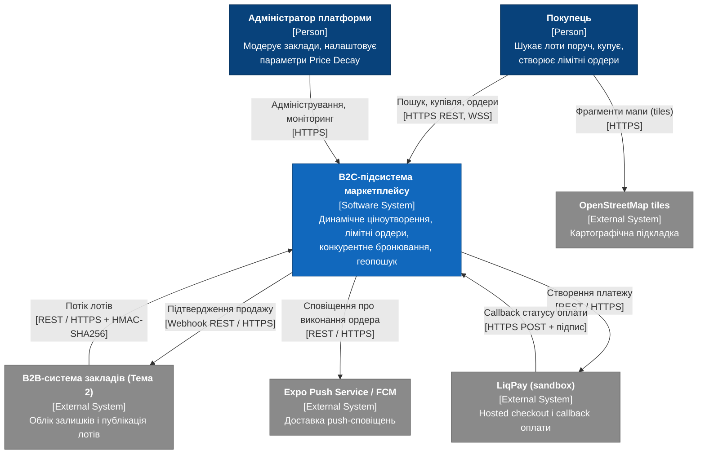
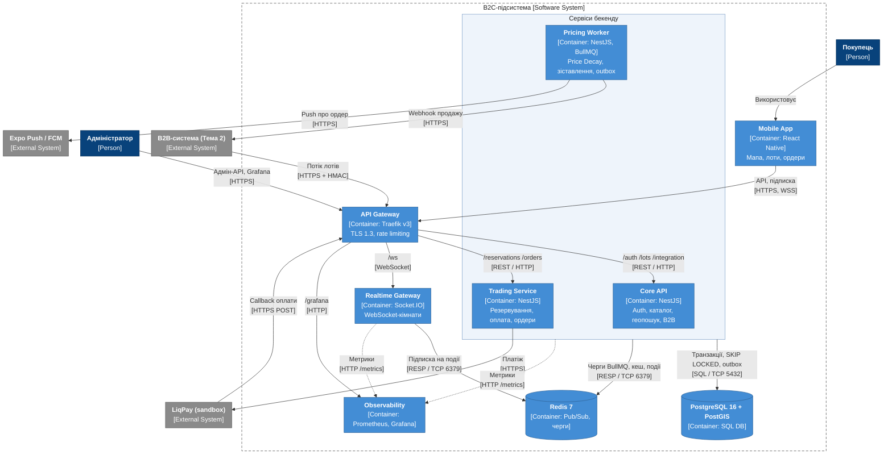
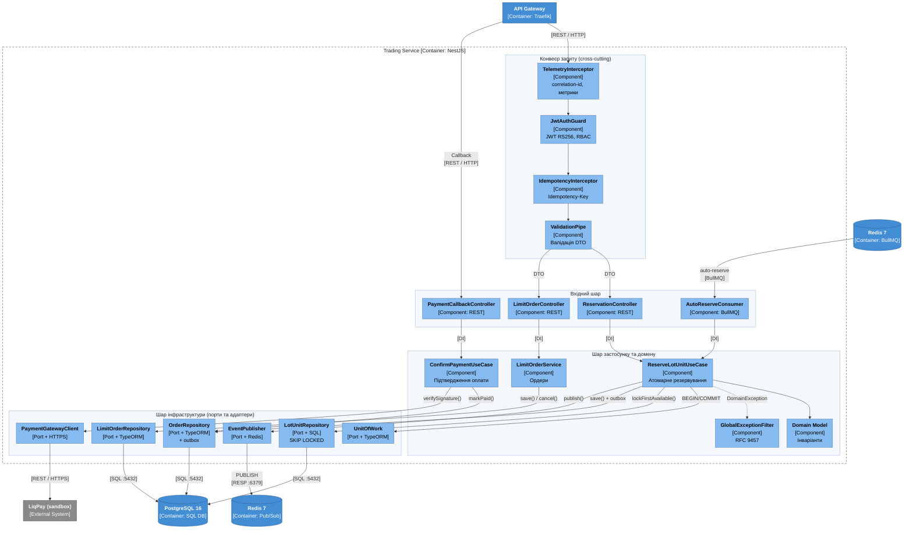
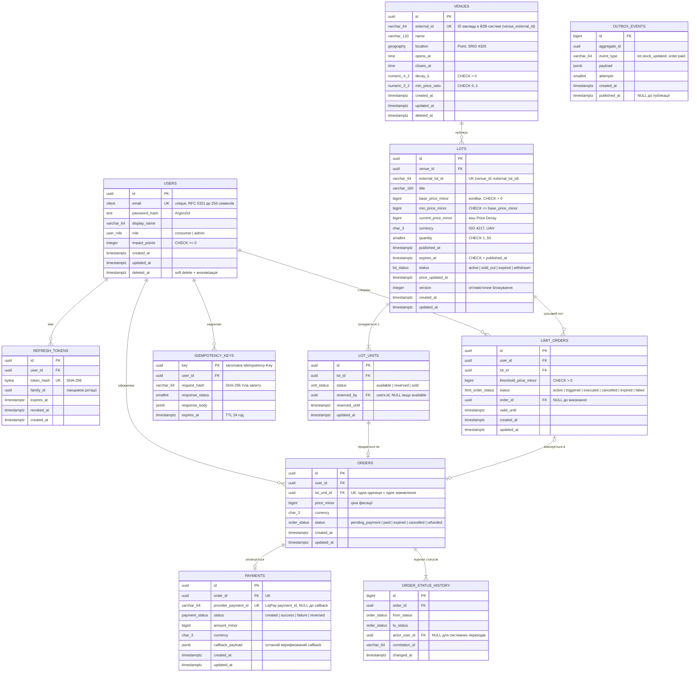
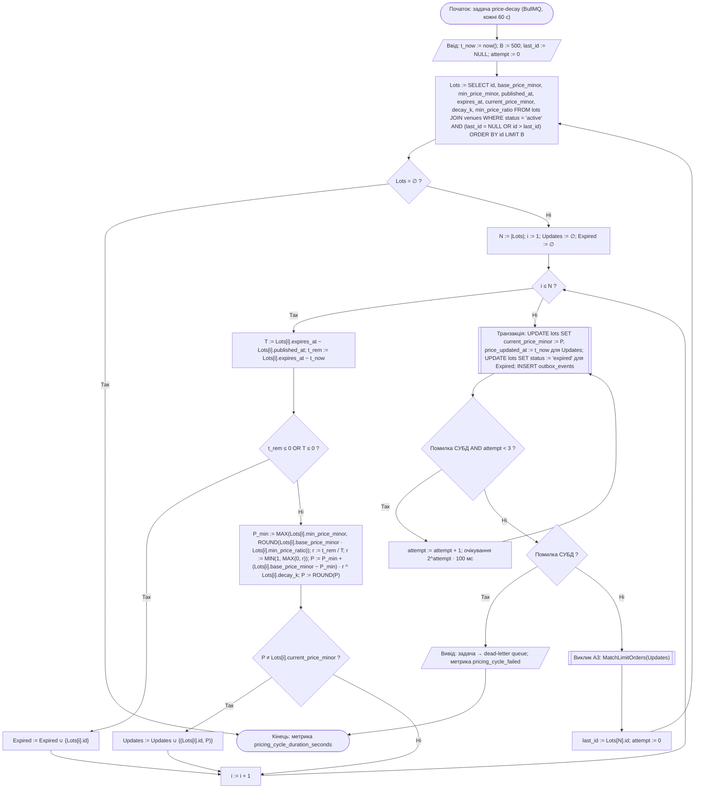
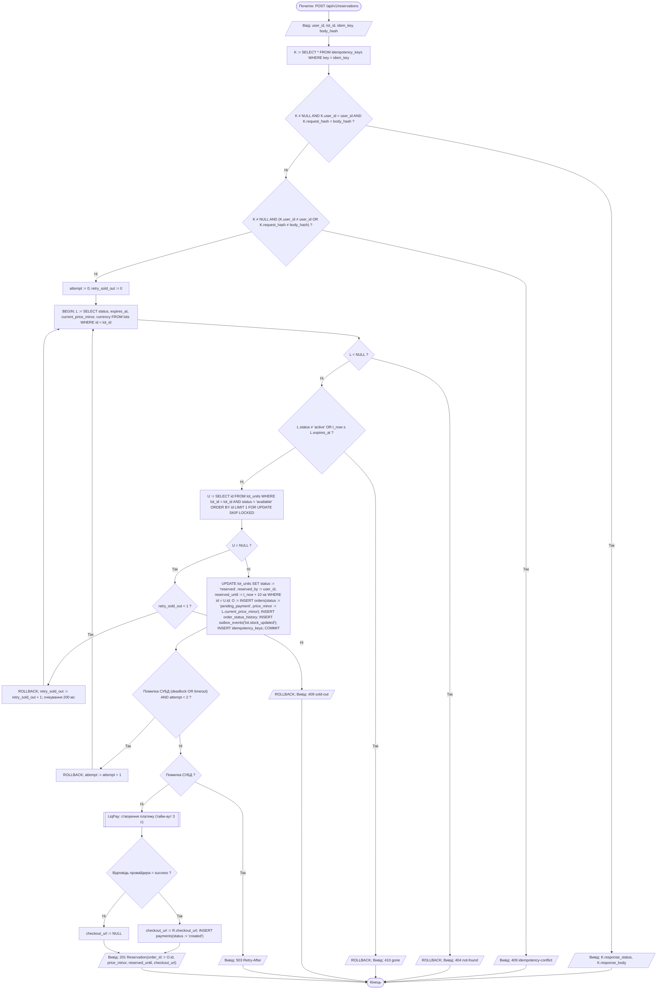
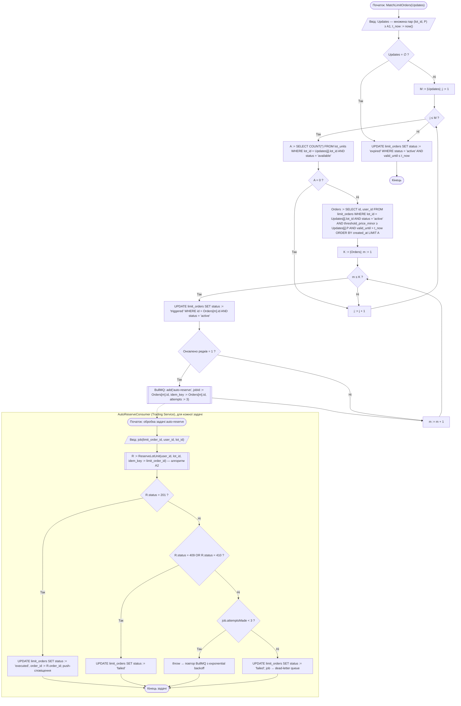

# РОЗДІЛ 2. ПРОЄКТУВАННЯ АРХІТЕКТУРИ СИСТЕМИ

Вхідний контракт вимог: [srs.md](./srs.md). Архітектурні рішення:
[adr/](./adr/). API-контракти: [api/openapi.yaml](./api/openapi.yaml).

## 2.1. Контекстне та контейнерне моделювання системи (C4 Model)

Діаграми побудовано в нотації C4 (Simon Brown) засобами Mermaid
`flowchart`: тип елемента вказано стереотипом у підписі ([Person],
[Software System], [External System], [Container: …],
[Component: …]), кольори відповідають палітрі C4, кожен зв'язок
підписано дією та протоколом у квадратних дужках. Вбудований
синтаксис `C4Context`/`C4Container` у Mermaid не розводить підписи
зв'язків і дає накладання тексту, тому для читабельності обрано
`flowchart` з автоматичною розкладкою.

### 2.1.1. C4 Level 1 — System Context

**Опис вузлів і зв'язків (Level 1):**

| Елемент | Тип | Відповідальність | Протокол |
|---|---|---|---|
| Покупець | Person | використовує мобільний клієнт | HTTPS REST, WSS |
| Адміністратор платформи | Person | адміністративні методи REST API, Grafana | HTTPS |
| B2C-підсистема | System | предмет кваліфікаційної роботи | — |
| B2B-система (Тема 2) | External System | джерело лотів ([SRS-FUN-01](./srs.md#srs-fun-01)), отримувач підтверджень ([SRS-FUN-12](./srs.md#srs-fun-12)) | REST / HTTPS, HMAC-SHA256 |
| LiqPay (sandbox) | External System | оплата без обробки даних карток ([SRS-NFR-COMP-02](./srs.md#srs-nfr-comp-02)) | REST / HTTPS, підписаний callback |
| Expo Push / FCM | External System | сповіщення про виконання лімітного ордера | REST / HTTPS |
| OpenStreetMap tiles | External System | картографічна підкладка клієнта | HTTPS |

### 2.1.2. C4 Level 2 — Container Diagram

**Опис контейнерів і трасування вимог (Level 2):**

| Контейнер | Технологія | Реалізовані вимоги | Рішення |
|---|---|---|---|
| Mobile App | React Native (Expo) | клієнт для [SRS-FUN-05](./srs.md#srs-fun-05), [SRS-FUN-13](./srs.md#srs-fun-13), [SRS-FUN-15](./srs.md#srs-fun-15) | — |
| API Gateway | Traefik v3 | [SRS-FUN-16](./srs.md#srs-fun-16), [SRS-NFR-SEC-02](./srs.md#srs-nfr-sec-02) | — |
| Core API | NestJS | [SRS-FUN-01](./srs.md#srs-fun-01)–[SRS-FUN-06](./srs.md#srs-fun-06), [SRS-FUN-17](./srs.md#srs-fun-17)–[SRS-FUN-19](./srs.md#srs-fun-19) | — |
| Trading Service | NestJS | [SRS-FUN-09](./srs.md#srs-fun-09), [SRS-FUN-11](./srs.md#srs-fun-11), [SRS-FUN-13](./srs.md#srs-fun-13), [SRS-FUN-14](./srs.md#srs-fun-14), [SRS-NFR-CONS-01](./srs.md#srs-nfr-cons-01) | [ADR-001](./adr/0001-choice-of-technology.md) |
| Pricing Worker | NestJS + BullMQ | [SRS-FUN-07](./srs.md#srs-fun-07), [SRS-FUN-08](./srs.md#srs-fun-08), [SRS-FUN-10](./srs.md#srs-fun-10), [SRS-FUN-12](./srs.md#srs-fun-12), [SRS-NFR-REL-03](./srs.md#srs-nfr-rel-03) | — |
| Realtime Gateway | NestJS + Socket.IO + Redis adapter | [SRS-FUN-15](./srs.md#srs-fun-15), [SRS-FUN-20](./srs.md#srs-fun-20), [SRS-NFR-PERF-03](./srs.md#srs-nfr-perf-03), [SRS-NFR-SCAL-01](./srs.md#srs-nfr-scal-01) | — |
| PostgreSQL 16 + PostGIS | SQL | єдине джерело істини, [SRS-NFR-REL-02](./srs.md#srs-nfr-rel-02) | [ADR-001](./adr/0001-choice-of-technology.md) |
| Redis 7 | BullMQ, Pub/Sub | транспорт задач і подій; не бере участі в гарантії коректності | [ADR-001](./adr/0001-choice-of-technology.md) |
| Observability | Prometheus, Grafana, Loki | [SRS-NFR-OBS-01](./srs.md#srs-nfr-obs-01), [SRS-NFR-REL-01](./srs.md#srs-nfr-rel-01) | — |

Core API, Trading Service і Pricing Worker на діаграмі згруповано в
«Сервіси бекенду», щоб спільні зв'язки зі сховищами не дублювалися:
усі три сервіси звертаються до PostgreSQL (SQL / TCP 5432) і Redis
(RESP / TCP 6379) — Core API для каталогу, геопошуку й кешу, Trading
Service для транзакцій SKIP LOCKED і задач auto-reserve, Pricing Worker
для пакетного оновлення цін, outbox і черг BullMQ; метрики всіх
сервісів збирає Observability через HTTP `/metrics`.
Протоколи: зовнішній трафік — лише через API Gateway (REST / HTTPS,
WSS, TLS 1.3); внутрішній трафік у мережі Docker — REST / HTTP і
WebSocket; доступ до сховищ — SQL / TCP 5432 та RESP / TCP 6379.
Контейнер Trading Service [C4 Container](#diagram-level2) реалізує
вимогу атомарного резервування [SRS-FUN-09](./srs.md#srs-fun-09) та
базується на рішенні [ADR-001](./adr/0001-choice-of-technology.md)
щодо `SELECT FOR UPDATE SKIP LOCKED`.

## 2.2. Компонентне моделювання критичного сервісу системи

### 2.2.1. C4 Level 3 — Component Diagram: Trading Service

Обрано Trading Service як контейнер з найбільшим інженерним ризиком:
він реалізує конкурентне резервування, оплату та виконання лімітних
ордерів.

### 2.2.2. Опис компонентів

**Наскрізні компоненти (cross-cutting).**

| Компонент | Роль | Вимоги |
|---|---|---|
| JwtAuthGuard | перевіряє підпис і строк дії access JWT, роль користувача | [SRS-FUN-04](./srs.md#srs-fun-04), [SRS-NFR-SEC-01](./srs.md#srs-nfr-sec-01) |
| ValidationPipe | відхиляє некоректні DTO з кодом 400 до входу в контролер | [SRS-NFR-SEC-04](./srs.md#srs-nfr-sec-04) |
| IdempotencyInterceptor | повертає збережену відповідь для повторного `Idempotency-Key` | [SRS-FUN-11](./srs.md#srs-fun-11) |
| GlobalExceptionFilter | перетворює доменні винятки на RFC 9457 (409 — немає одиниць, 410 — лот прострочений) | [SRS-FUN-09](./srs.md#srs-fun-09) |
| TelemetryInterceptor | JSON-логи з correlation-id, гістограма `http_request_duration_seconds` | [SRS-NFR-OBS-01](./srs.md#srs-nfr-obs-01) |

**Вхідний шар (Inbound).** `ReservationController`,
`LimitOrderController` і `PaymentCallbackController` не містять
бізнес-логіки й не мають доступу до репозиторіїв: вони перетворюють
DTO на команду та викликають відповідний use case через інтерфейс,
зареєстрований у DI-контейнері NestJS. `AutoReserveConsumer` споживає
задачі `limit-order.triggered`, які створює Pricing Worker, і
викликає той самий `ReserveLotUnitUseCase`, що й REST-контролер; отже,
ручна та автоматична купівля проходять однаковий шлях резервування
([SRS-FUN-14](./srs.md#srs-fun-14)).

**Шар застосунку та домену (Core).** `ReserveLotUnitUseCase` відкриває
транзакцію через `UnitOfWork`, викликає
`LotUnitRepository.lockFirstAvailable()`, перевіряє інваріанти
доменної моделі (лот не прострочений, ціна зафіксована), зберігає
замовлення й outbox-запис і після коміту публікує подію
`lot.stock_updated`. `ConfirmPaymentUseCase` перевіряє підпис
callback і переводить замовлення в `paid` лише з дозволеного стану.
Доменна модель не залежить від NestJS, TypeORM чи Redis.
`PaymentCallbackController` не проходить через `JwtAuthGuard`, оскільки
запит надходить від LiqPay: автентичність підтверджується перевіркою
підпису callback у `ConfirmPaymentUseCase`.

**Шар інфраструктури (Outbound).** Репозиторії, клієнт платежів і
публікатор подій оголошено як порти (TypeScript-інтерфейси) у шарі
застосунку, а реалізації — як адаптери в інфраструктурному модулі
(Dependency Inversion). `LotUnitRepository` використовує сирий SQL
для `FOR UPDATE SKIP LOCKED` відповідно до
[ADR-001](./adr/0001-choice-of-technology.md); інші репозиторії —
TypeORM.

## 2.3. Документування архітектурних рішень (Architecture Decision Records)

| ADR | Рішення | Статус |
|---|---|---|
| [ADR-001](./adr/0001-choice-of-technology.md) | `SELECT FOR UPDATE SKIP LOCKED` для конкурентного бронювання | Approved |

## 2.4. Проєктування та моделювання баз даних

Шар збереження даних реалізовано в одному вузлі PostgreSQL 16 з
розширенням PostGIS (контейнер «PostgreSQL 16 + PostGIS»,
[C4 Container](#diagram-level2)). Схема відповідає третій нормальній
формі; єдиний свідомо збережений похідний атрибут —
`lots.current_price_minor` (кеш функції Price Decay, оновлюється
раз на 60 с алгоритмом A1, див. 2.6). Доменна сутність PriceSnapshot
з підрозділу 1.4.2 реалізована полями `current_price_minor` і
`price_updated_at` лота: історія цін не зберігається, оскільки ціна
детерміновано відновлюється з параметрів лота (10 000 лотів × 1 440
циклів на добу дали б 14,4 млн рядків на добу).

Конвенції: первинні ключі — `uuid` (v7, монотонні для B-Tree), крім
журнальних таблиць (`bigint GENERATED ALWAYS AS IDENTITY`); суми —
`bigint` у копійках (`*_minor`) + `char(3)` ISO 4217; мітки часу —
`timestamptz` (UTC); статуси — типи `ENUM`; `varchar_N` на діаграмі
означає `varchar(N)`, `numeric_P_S` — `numeric(P,S)`.

### 2.4.1. ER-діаграма (Mermaid, Crow's Foot)

### 2.4.2. Специфікація таблиць

**ENUM-типи:** `user_role` (consumer, admin); `lot_status` (active,
sold_out, expired, withdrawn); `unit_status` (available, reserved,
sold); `order_status` (pending_payment, paid, expired, cancelled,
refunded); `payment_status` (created, success, failure, reversed);
`limit_order_status` (active, triggered, executed, cancelled,
expired, failed).

| Таблиця | Призначення | Ключові обмеження | Вимоги |
|---|---|---|---|
| `users` | обліковий запис покупця або адміністратора | `email` CITEXT UNIQUE; `impact_points >= 0`; `deleted_at` + анонімізація персональних полів протягом 30 діб | [SRS-FUN-03](./srs.md#srs-fun-03), [SRS-FUN-17](./srs.md#srs-fun-17), [SRS-FUN-18](./srs.md#srs-fun-18) |
| `refresh_tokens` | ротація refresh-токенів | `token_hash` UNIQUE; `family_id` для відкликання ланцюжка при повторному використанні | [SRS-FUN-04](./srs.md#srs-fun-04) |
| `venues` | заклад і параметри Price Decay | `external_id` UNIQUE; `decay_k > 0`; `0 <= min_price_ratio <= 1` | [SRS-FUN-05](./srs.md#srs-fun-05), [SRS-FUN-19](./srs.md#srs-fun-19) |
| `lots` | лот закладу, кеш поточної ціни | UNIQUE (`venue_id`, `external_lot_id`); `min_price_minor <= base_price_minor`; `expires_at > published_at`; `quantity` 1..50; `version` | [SRS-FUN-02](./srs.md#srs-fun-02), [SRS-FUN-07](./srs.md#srs-fun-07), [SRS-FUN-08](./srs.md#srs-fun-08) |
| `lot_units` | одиниця лота як об'єкт блокування | `reserved_by` / `reserved_until` NOT NULL тоді й лише тоді, коли `status = 'reserved'` (CHECK) | [SRS-FUN-09](./srs.md#srs-fun-09), [SRS-FUN-10](./srs.md#srs-fun-10), [ADR-001](./adr/0001-choice-of-technology.md) |
| `orders` | замовлення з ціною фіксації | `lot_unit_id` UNIQUE (одна одиниця — одне замовлення) | [SRS-FUN-09](./srs.md#srs-fun-09), [SRS-FUN-11](./srs.md#srs-fun-11) |
| `payments` | платіж LiqPay | `order_id` UNIQUE; `provider_payment_id` UNIQUE, NULL до callback | [SRS-FUN-11](./srs.md#srs-fun-11), [SRS-NFR-COMP-02](./srs.md#srs-nfr-comp-02) |
| `order_status_history` | журнал аудиту переходів статусів | append-only; `correlation_id` | [SRS-NFR-SEC-05](./srs.md#srs-nfr-sec-05) |
| `limit_orders` | лімітний ордер | `threshold_price_minor > 0`; частковий UNIQUE (`user_id`, `lot_id`) WHERE `status = 'active'` | [SRS-FUN-13](./srs.md#srs-fun-13), [SRS-FUN-14](./srs.md#srs-fun-14) |
| `idempotency_keys` | збережені відповіді на повторні запити | PK `key`; TTL 24 год (очищення фоновою задачею) | [SRS-FUN-11](./srs.md#srs-fun-11) |
| `outbox_events` | transactional outbox | `published_at` NULL до відправки; `attempts` для backoff | [SRS-FUN-12](./srs.md#srs-fun-12), [SRS-NFR-REL-03](./srs.md#srs-nfr-rel-03) |

### 2.4.3. План індексування

| Індекс | Тип | Запит, який прискорює | Вимога |
|---|---|---|---|
| `venues (location)` | GiST | `ST_DWithin` у `GET /api/v1/lots` | [SRS-NFR-PERF-01](./srs.md#srs-nfr-perf-01) |
| `lots (venue_id) WHERE status = 'active'` | B-Tree, частковий | лоти закладів у радіусі | [SRS-NFR-PERF-01](./srs.md#srs-nfr-perf-01) |
| `lots (id) WHERE status = 'active'` | B-Tree, частковий | keyset-пагінація циклу A1 | [SRS-NFR-PERF-04](./srs.md#srs-nfr-perf-04) |
| `lot_units (lot_id, id) WHERE status = 'available'` | B-Tree, частковий | `FOR UPDATE SKIP LOCKED` в A2, `COUNT` в A3 | [SRS-NFR-PERF-02](./srs.md#srs-nfr-perf-02), [ADR-001](./adr/0001-choice-of-technology.md) |
| `lot_units (reserved_until) WHERE status = 'reserved'` | B-Tree, частковий | звільнення резервів після TTL | [SRS-FUN-10](./srs.md#srs-fun-10) |
| `limit_orders (lot_id, threshold_price_minor) WHERE status = 'active'` | B-Tree, частковий | пошук ордерів для виконання в A3 | [SRS-FUN-14](./srs.md#srs-fun-14) |
| `orders (user_id, created_at DESC)` | B-Tree | історія замовлень користувача | — |
| `outbox_events (id) WHERE published_at IS NULL` | B-Tree, частковий | outbox relay Pricing Worker | [SRS-NFR-REL-03](./srs.md#srs-nfr-rel-03) |
| `idempotency_keys (expires_at)` | B-Tree | очищення застарілих ключів | — |
| `refresh_tokens (user_id) WHERE revoked_at IS NULL` | B-Tree, частковий | відкликання сесій | [SRS-FUN-04](./srs.md#srs-fun-04) |

## 2.5. Специфікація міжсервісних контрактів (API)

Контракти спроєктовано за підходом API-First у форматі OpenAPI 3.0.3.
Деталізовану специфікацію ендпоінтів, схем даних, авторизації та
помилок зафіксовано у файлі [openapi.yaml](./api/openapi.yaml).

| Операція | Взаємодія контейнерів ([C4 Level 2](#diagram-level2)) | Авторизація | Успіх | Документовані помилки | Вимоги |
|---|---|---|---|---|---|
| `GET /api/v1/lots` | Mobile App → API Gateway → Core API | JWT Bearer | 200 | 400, 401, 429, 500 | [SRS-FUN-05](./srs.md#srs-fun-05), [SRS-NFR-PERF-01](./srs.md#srs-nfr-perf-01) |
| `POST /integration/v1/lots` | B2B-система → API Gateway → Core API | HMAC-SHA256 (`X-Signature`) | 200 / 201 | 400, 401, 404, 409, 429, 500 | [SRS-FUN-01](./srs.md#srs-fun-01), [SRS-FUN-02](./srs.md#srs-fun-02) |
| `POST /api/v1/reservations` | Mobile App → API Gateway → Trading Service | JWT Bearer + `Idempotency-Key` | 201 | 400, 401, 404, 409, 410, 429, 503 | [SRS-FUN-09](./srs.md#srs-fun-09), [SRS-NFR-PERF-02](./srs.md#srs-nfr-perf-02) |
| `GET /api/v1/orders/{order_id}` | Mobile App → API Gateway → Trading Service | JWT Bearer | 200 | 401, 403, 404, 500 | [SRS-FUN-11](./srs.md#srs-fun-11) |
| `POST /api/v1/limit-orders` | Mobile App → API Gateway → Trading Service | JWT Bearer + `Idempotency-Key` | 201 | 400, 401, 404, 409, 410, 429, 500 | [SRS-FUN-13](./srs.md#srs-fun-13) |
| `DELETE /api/v1/limit-orders/{limit_order_id}` | Mobile App → API Gateway → Trading Service | JWT Bearer | 204 | 401, 403, 404, 409, 500 | [SRS-FUN-13](./srs.md#srs-fun-13) |
| `POST /api/v1/payments/liqpay/callback` | LiqPay → API Gateway → Trading Service | підпис LiqPay | 200 | 400, 500 | [SRS-FUN-11](./srs.md#srs-fun-11), [SRS-FUN-12](./srs.md#srs-fun-12) |

Наскрізні правила контракту: помилки повертаються у форматі RFC 9457
(`application/problem+json`, схема `Problem` / `ValidationProblem`);
відповідь 429 містить заголовки `Retry-After`, `RateLimit-Limit`,
`RateLimit-Remaining` ([SRS-FUN-16](./srs.md#srs-fun-16)); операції,
що змінюють стан від імені користувача, вимагають заголовка
`Idempotency-Key`; кожна операція приймає `X-Correlation-Id`
([SRS-NFR-OBS-01](./srs.md#srs-nfr-obs-01)). Внутрішня взаємодія
Pricing Worker → Trading Service виконується не через REST, а через
задачі BullMQ `auto-reserve` (Redis, RESP), тому до HTTP-контракту не
входить.

## 2.6. Моделювання логіки критичних вузлів

Позначення: `:=` — присвоювання; `=`, `≠`, `<`, `≤`, `≥` — лише
порівняння в умовах; логічні зв'язки — AND, OR, NOT; `X[i]` — i-й
елемент колекції X (нумерація з 1); `|X|` — потужність множини;
`∅` — порожня множина. Блоки схем: овал — термінатор, паралелограм —
введення/виведення, прямокутник — процес, ромб — рішення, прямокутник
з подвійними бічними сторонами — зумовлений процес (підпрограма,
транзакція або зовнішній виклик).

### 2.6.1. Алгоритм A1 — циклічний перерахунок ціни (Price Decay)

Контейнер: Pricing Worker; вимоги
[SRS-FUN-07](./srs.md#srs-fun-07), [SRS-FUN-08](./srs.md#srs-fun-08),
[SRS-FUN-19](./srs.md#srs-fun-19), [SRS-NFR-PERF-04](./srs.md#srs-nfr-perf-04).

1. `t_now := now()`; `B := 500`; `last_id := NULL`; `attempt := 0`.
2. `Lots := SELECT … FROM lots JOIN venues WHERE status = 'active' AND (last_id = NULL OR id > last_id) ORDER BY id LIMIT B` (keyset-пагінація).
3. Якщо `Lots = ∅` — кінець циклу.
4. `N := |Lots|`; `i := 1`; `Updates := ∅`; `Expired := ∅`.
5. Поки `i ≤ N`:
   1. `T := Lots[i].expires_at − Lots[i].published_at`; `t_rem := Lots[i].expires_at − t_now`.
   2. Якщо `t_rem ≤ 0 OR T ≤ 0`: `Expired := Expired ∪ {Lots[i].id}`.
   3. Інакше: `P_min := MAX(Lots[i].min_price_minor, ROUND(Lots[i].base_price_minor · Lots[i].min_price_ratio))`; `r := MIN(1, MAX(0, t_rem / T))`; `P := ROUND(P_min + (Lots[i].base_price_minor − P_min) · r ^ Lots[i].decay_k)`; якщо `P ≠ Lots[i].current_price_minor`: `Updates := Updates ∪ {(Lots[i].id, P)}`.
   4. `i := i + 1`.
6. Транзакція: пакетний `UPDATE` цін для `Updates`, `status := 'expired'` для `Expired`, запис подій в `outbox_events`.
7. Якщо помилка СУБД `AND attempt < 3`: `attempt := attempt + 1`, очікування `2^attempt · 100` мс, повтор кроку 6; якщо помилка після 3 спроб — задача переходить у dead-letter queue, кінець.
8. Виклик A3 `MatchLimitOrders(Updates)`; `last_id := Lots[N].id`; `attempt := 0`; перехід до кроку 2.

Edge cases: порожня вибірка (крок 3); `T ≤ 0` через некоректні дані
B2B-системи (лот знімається з продажу замість ділення на нуль);
обмеження `r` відрізком [0, 1]; оновлюються лише змінені ціни;
кількість повторів транзакції обмежена трьома.

### 2.6.2. Алгоритм A2 — атомарне резервування одиниці лота

Контейнер: Trading Service (`ReserveLotUnitUseCase`, [C4 Level 3](#diagram-level3));
вимоги [SRS-FUN-09](./srs.md#srs-fun-09), [SRS-FUN-10](./srs.md#srs-fun-10),
[SRS-NFR-CONS-01](./srs.md#srs-nfr-cons-01); рішення
[ADR-001](./adr/0001-choice-of-technology.md).

1. Ввід: `user_id`, `lot_id`, `idem_key`, `body_hash`.
2. `K := SELECT * FROM idempotency_keys WHERE key = idem_key`.
3. Якщо `K ≠ NULL AND K.user_id = user_id AND K.request_hash = body_hash` — вивід збереженої відповіді, кінець.
4. Якщо `K ≠ NULL AND (K.user_id ≠ user_id OR K.request_hash ≠ body_hash)` — вивід 409 `idempotency-conflict`, кінець.
5. `attempt := 0`; `retry_sold_out := 0`.
6. `BEGIN`; `L := SELECT status, expires_at, current_price_minor, currency FROM lots WHERE id = lot_id`.
7. Якщо `L = NULL` — `ROLLBACK`, вивід 404. Якщо `L.status ≠ 'active' OR t_now ≥ L.expires_at` — `ROLLBACK`, вивід 410.
8. `U := SELECT id FROM lot_units WHERE lot_id = lot_id AND status = 'available' ORDER BY id LIMIT 1 FOR UPDATE SKIP LOCKED`.
9. Якщо `U = NULL`: якщо `retry_sold_out < 1` — `ROLLBACK`, `retry_sold_out := retry_sold_out + 1`, очікування 200 мс, перехід до кроку 6 (захист від хибного «розпродано», ADR-001); інакше — `ROLLBACK`, вивід 409 `sold-out`.
10. `status := 'reserved'`, `reserved_by := user_id`, `reserved_until := t_now + 10 хв` для `U`; `INSERT orders` з `status := 'pending_payment'`, `price_minor := L.current_price_minor`; `INSERT order_status_history`; `INSERT outbox_events ('lot.stock_updated')`; `INSERT idempotency_keys`; `COMMIT`.
11. Якщо помилка СУБД (deadlock `OR` timeout) `AND attempt < 2` — `ROLLBACK`, `attempt := attempt + 1`, перехід до кроку 6; якщо помилка після повторів — вивід 503 з `Retry-After`.
12. Створення платежу LiqPay (тайм-аут 3 с, поза транзакцією): якщо відповідь успішна — `checkout_url := R.checkout_url`, `INSERT payments (status := 'created')`; інакше `checkout_url := NULL` (резерв зберігається до спливу TTL, клієнт повторює `GET /api/v1/orders/{order_id}`).
13. Вивід 201 `Reservation`.

Edge cases: повторний запит після мережевого збою (кроки 2–4);
неіснуючий або прострочений лот (крок 7); хибна відповідь
«розпродано» через ROLLBACK конкурентної транзакції (крок 9);
deadlock і тайм-аут СУБД (крок 11); недоступність платіжного
провайдера (крок 12) — не скасовує резерв.

### 2.6.3. Алгоритм A3 — виконання лімітних ордерів

Контейнери: Pricing Worker (зіставлення) і Trading Service
(`AutoReserveConsumer`); вимоги [SRS-FUN-13](./srs.md#srs-fun-13),
[SRS-FUN-14](./srs.md#srs-fun-14).

1. Ввід: `Updates` — множина пар `(lot_id, P)` з A1; `t_now := now()`.
2. Якщо `Updates = ∅` — перехід до кроку 5.
3. `M := |Updates|`; для `j := 1 … M`:
   1. `A := SELECT COUNT(*) FROM lot_units WHERE lot_id = Updates[j].lot_id AND status = 'available'`; якщо `A = 0` — наступне `j`.
   2. `Orders := SELECT id, user_id FROM limit_orders WHERE lot_id = Updates[j].lot_id AND status = 'active' AND threshold_price_minor ≥ Updates[j].P AND valid_until > t_now ORDER BY created_at LIMIT A` (FIFO за часом створення, не більше доступних одиниць).
   3. Для `m := 1 … |Orders|`: `UPDATE limit_orders SET status := 'triggered' WHERE id = Orders[m].id AND status = 'active'`; якщо оновлено рівно 1 рядок — задача BullMQ `auto-reserve` з `jobId := Orders[m].id`, `idem_key := Orders[m].id`, `attempts := 3`.
4. Кінець циклу за `j`.
5. `UPDATE limit_orders SET status := 'expired' WHERE status = 'active' AND valid_until ≤ t_now`.
6. Обробник задачі (`AutoReserveConsumer`): `R := ReserveLotUnit(user_id, lot_id, idem_key)` (A2); якщо `R.status = 201` — `status := 'executed'`, `order_id := R.order_id`, push-сповіщення; якщо `R.status = 409 OR R.status = 410` — `status := 'failed'`; інакше, якщо `job.attemptsMade < 3` — повтор з exponential backoff, інакше `status := 'failed'` і dead-letter queue.

Edge cases: порожня множина оновлень (крок 2); відсутність вільних
одиниць (крок 3.1); конкурентне скасування ордера користувачем
(умова `status = 'active'` в `UPDATE` кроку 3.3 — ордер не
запускається двічі); повторна доставка задачі BullMQ (`jobId` та
`idem_key` збігаються з id ордера — A2 поверне збережену відповідь); прострочені
ордери (крок 5). A3 викликається після запису кожної пачки з
`B := 500` лотів алгоритму A1, тому затримка між зниженням ціни до
порога і постановкою задачі `auto-reserve` обмежена часом обробки
однієї пачки, що узгоджується з [SRS-FUN-14](./srs.md#srs-fun-14)
(≤ 5 с).

## 2.7. Інтеграційний аудит та верифікація цілісності доменів

Проведено наскрізну звірку схеми даних (2.4), контракту
[openapi.yaml](./api/openapi.yaml) (2.5), алгоритмів A1–A3 (2.6) та
[srs.md](./srs.md) за трьома осями: API ↔ БД, логіка ↔ API/БД,
вимоги ↔ артефакти.

### 2.7.1. Виявлені розбіжності та їх усунення

| № | Тип | Розбіжність | Усунення |
|---|---|---|---|
| 1 | API ↔ БД | API передає `venue_external_id`, у таблиці `venues` поле називалося `merchant_external_id` без обмеження унікальності | поле перейменовано на `venues.external_id` з `UNIQUE` |
| 2 | вимоги ↔ БД | SRS-FUN-02 задавала ключ ідемпотентності `(merchant_id, external_lot_id)`, а схема — `UNIQUE (venue_id, external_lot_id)` | SRS-FUN-02 узгоджено: ключ `(venue_external_id, external_lot_id)` |
| 3 | вимоги ↔ API | SRS-NFR-PERF-01 посилалася на `GET /lots/nearby`; за рекомендацією API-рев'ю шлях змінено на ресурс-колекцію | SRS-NFR-PERF-01 посилається на `GET /api/v1/lots` |
| 4 | БД (3NF) | `reserved_until` зберігалося і в `lot_units`, і в `orders` (аномалія оновлення при продовженні або звільненні резерву) | поле видалено з `orders`; `Order.reserved_until` в API береться з `lot_units` |
| 5 | логіка ↔ БД | мінімальна ціна мала два джерела: `lots.min_price_minor` (потік B2B) і `venues.min_price_ratio` (адміністратор, SRS-FUN-19); A1 використовував лише перше | A1: `P_min := MAX(min_price_minor, ROUND(base_price_minor · min_price_ratio))` |
| 6 | логіка ↔ БД | A2 створює запис `payments` до callback, а `provider_payment_id` був задекларований як обов'язковий | `provider_payment_id` допускає NULL до callback (UNIQUE ігнорує NULL у PostgreSQL) |

### 2.7.2. Перевірені інваріанти (без розбіжностей)

- Ідентифікатори: `uuid` у БД ↔ `string, format: uuid` в API.
- Гроші: `bigint` у копійках ↔ `integer, format: int64` (`*_minor`) + `currency` ISO 4217 в обох шарах; дробові типи не використовуються.
- Час: `timestamptz` ↔ `string, format: date-time` (RFC 3339, UTC).
- Статуси: множини значень ENUM `lot_status`, `order_status`, `limit_order_status` збігаються зі схемами `LotStatus`, `OrderStatus`, `LimitOrderStatus` і зі значеннями, які присвоюють A1–A3 (`expired`, `reserved`, `pending_payment`, `triggered`, `executed`, `failed`).
- Обмеження: `quantity` 1..50 (`smallint` + CHECK ↔ `minimum: 1, maximum: 50`); `radius_km` 0,5..10 (API ↔ SRS-FUN-05).
- Колекції та індекси в алгоритмах (`Lots[i]`, `Updates[j]`, `Orders[m]`) відповідають таблицям `lots`, `limit_orders` та повертаються запитами, підкріпленими індексами з 2.4.3.
- Ідемпотентність: `Idempotency-Key` (API) ↔ `idempotency_keys` (БД) ↔ кроки 2–4 A2 ↔ `jobId` A3.

### 2.7.3. Production Readiness Report

| Критерій | Статус |
|---|---|
| Кожна операція API має таблицю-джерело та типи без втрати точності | виконано |
| Кожен статус, який присвоюють алгоритми, існує в ENUM БД і в схемі API | виконано |
| Кожен алгоритм має обмеження повторів, обробку порожніх даних і помилок СУБД або зовнішнього сервісу | виконано |
| Кожна змінювальна операція ідемпотентна (Idempotency-Key, upsert за природним ключем або `jobId`) | виконано |
| Критичні бізнес-сценарії (SRS-FUN-01, 02, 05, 07–14, 16) мають відображення в API, БД та алгоритмах | виконано |
| SRS-FUN-03, 04, 06, 15, 17–20 мають відображення в схемі БД; їхні API-контракти не входять у критичний сценарій ЛР | відкладено до Розділу 3 |
| Критичні блокери (showstoppers) | відсутні |

Висновок: специфікації шару даних, міжсервісних контрактів і логіки
критичних вузлів узгоджені між собою та з [srs.md](./srs.md) і
[ADR-001](./adr/0001-choice-of-technology.md) і готові до реалізації
в Розділі 3. Некритичні пункти, що переносяться в реалізацію:
алгоритм звільнення резервів після TTL (SRS-FUN-10) реалізується
окремою задачею Pricing Worker за індексом
`lot_units (reserved_until)`; контракти автентифікації (SRS-FUN-03,
04), кластеризації (SRS-FUN-06), адміністративного API (SRS-FUN-19),
видалення акаунта (SRS-FUN-17) та WebSocket-подій (SRS-FUN-15, 20)
буде специфіковано разом з їхньою реалізацією.
